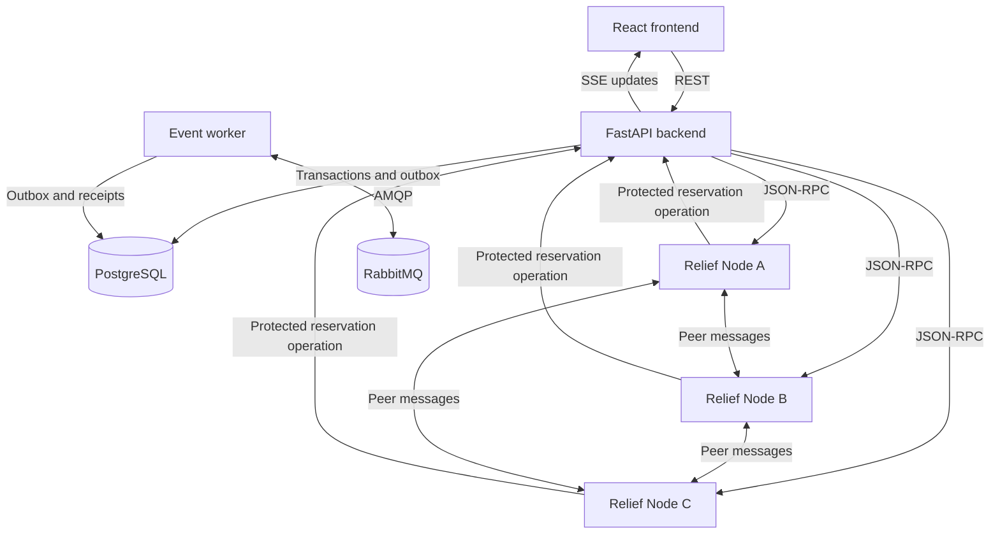

# ReliefNet

**Distributed Disaster Response and Resource Coordination System**

ReliefNet is a Distributed Systems Laboratory project for coordinating simulated disaster incidents and relief resources across three independent relief centers. It combines a React command-center interface with FastAPI services, PostgreSQL transactions, RabbitMQ events and observable distributed algorithms.

All incidents, resource quantities and affected-population figures are simulated. This is an academic prototype, not a production emergency dispatch system.

## Quick start

### Requirements

- Git.
- Docker Desktop running with Linux containers and Docker Compose.
- PowerShell for the supplied demonstration scripts.
- Internet access for the first image/package downloads and OpenStreetMap tiles.

For a fresh checkout:

```powershell
git clone https://github.com/GargiGogulwar/DS-FA.git
cd DS-FA
Copy-Item .env.example .env
docker compose up -d --build
docker compose ps
```

Host Python and Node.js installations are not required for the Docker workflow. The first build can take several minutes. The `migrate` service applies Alembic migrations and seeds the database before the backend starts; its successful `Exited (0)` state is expected.

| Interface | Local URL |
| --- | --- |
| Frontend | [http://localhost:5173](http://localhost:5173) |
| Backend health | [http://localhost:8000/health](http://localhost:8000/health) |
| Interactive API | [http://localhost:8000/docs](http://localhost:8000/docs) |

Only the frontend and backend publish host ports, both bound to loopback. PostgreSQL, RabbitMQ and the relief nodes communicate within the Compose network.

## Features

- **Incident management:** create, inspect, edit and delete eligible reports; validate coordinates, affected-population counts and resource requirements; retain event history and resolution notes.
- **Incident lifecycle:** `Reported → Verified → Assigned → In Progress → Resolved`. A reservation must be confirmed to assign a relief center.
- **Resource inventory:** per-center stock, replenishment, consumption, reserved quantities and available quantities.
- **Allocation:** rank centers by stock coverage, distance, capacity, incident severity and node health; reserve, confirm or cancel resources.
- **Consistency:** conditional SQL updates, database constraints, unique reservation keys and transactional assignment prevent competing requests from overselling stock.
- **Live monitoring:** SSE updates, automatic reconnection, event replay, connection indicators and a periodic authoritative refresh.
- **Command-center interface:** sixteen connected views covering overview, incident forms/details, mapping, centers, inventory, allocations, node health, election traces, logical clocks, snapshots, deadlocks, audit activity, SDG impact and demo settings.

The repeatable seed creates three Kerala relief centers, four incidents of different severities, seven resource types per center, 21 inventory lines and one pending allocation.

## Technology stack

| Layer | Technologies |
| --- | --- |
| Frontend | React, TypeScript, Vite, Tailwind CSS |
| Charts and maps | Recharts, React Leaflet, OpenStreetMap |
| API and node services | Python 3.12, FastAPI, Pydantic, HTTPX |
| Persistence | PostgreSQL 18.6, SQLAlchemy, Alembic |
| Messaging | RabbitMQ 3.13, Pika, transactional outbox |
| Communication | REST, JSON-RPC 2.0, peer HTTP, AMQP, SSE |
| Testing and deployment | Pytest, HTTPX, Docker, Docker Compose, PowerShell |

## Service architecture



Eight services run independently: `frontend`, `backend`, `node-a`, `node-b`, `node-c`, `postgres`, `rabbitmq` and `worker`. The one-shot `migrate` service handles database initialization. Container-to-container calls use service DNS names rather than host `localhost` addresses.

PostgreSQL is the authoritative store for incidents and inventory. Relief nodes coordinate reservation entry over the network, then call the backend to execute the database transaction. The worker publishes durable outbox events and consumes broker messages with persistent duplicate-event receipts.

## Distributed systems concepts

| Concept | Implementation and scope |
| --- | --- |
| JSON-RPC | Independent node methods: `inventory.query`, `node.status`, `reservation.request` and `incident.status`; request IDs, structured errors and HTTP timeouts. |
| Message-oriented communication | Durable RabbitMQ exchange/queues, publisher confirms, consumer acknowledgements, duplicate suppression and dead-letter handling. |
| Stream-oriented communication | SSE event delivery with logical cursors, replay and explicit browser reconnection after transport or HTTP failures. |
| Lamport clocks | Per-node local/receive rules; a persistent backend event order serialized through a PostgreSQL advisory lock. |
| Vector clocks | Separate tested module for merge operations, causal ordering and concurrent-event detection. |
| Bully election | Actual peer election requests and coordinator announcements. Default priorities are A = 1, B = 2 and C = 3. |
| Ricart–Agrawala | Timestamp ordering, deterministic node-ID tie-breaking, deferred replies and all-peer permission before reservation entry. |
| Heartbeat failure detection | Last-seen observations and suspected/unreachable states; UI failure simulation and real container stop/start tests. |
| Chandy–Lamport snapshot | Educational reliable-FIFO-channel simulator using sampled live node states; records markers and in-transit messages. |
| Deadlock detection | Editable wait-for graph with depth-first cycle detection. |

### Reservation behavior

Available stock is `stock - reserved`. Creating a reservation increases `reserved`; confirmation decreases both `stock` and `reserved`; cancellation releases the reserved quantity without consuming stock.

The selected relief node must obtain permission from both peers before requesting a reservation transaction. Inside the transaction, stock is reserved only when enough remains available. Reusing an idempotency key with the same request returns the existing reservation; reusing it for a different request is rejected.

### Recovery behavior

An unresponsive node is classified as suspected or unreachable; a timeout alone does not prove process termination. If coordinator C becomes unavailable, the remaining nodes can elect B. C can rejoin and announce itself after recovery.

During a broker outage, application changes remain in the database outbox. The worker retries delivery after reconnection. Unique consumer receipts suppress repeat processing after duplicate delivery.

## Run the tests

Start the complete stack and run these scripts **sequentially** from the repository root:

```powershell
.\scripts\test.ps1
.\scripts\fault-tests.ps1
```

`test.ps1` runs isolated backend tests, live distributed workflow checks and nginx configuration validation. The workflow checks create simulated incidents and reservations.

`fault-tests.ps1` temporarily stops and restarts Node C and RabbitMQ to verify failure detection, coordinator recovery, outbox persistence and reconciliation. Avoid running other demonstrations or tests concurrently with these outage scenarios.

Recorded local validation passed:

- 27 backend tests.
- 13 live distributed workflow checks.
- Four container outage/recovery probes.
- Frontend TypeScript/production build, database migrations and seed/reset.
- Desktop/mobile browser workflows and automatic SSE recovery after backend reset.

These results describe the tested local prototype; they are not a performance benchmark or a production availability guarantee.

## Demonstrate the application

1. Report a simulated incident, then open its details and verify it.
2. Choose **Find suitable centers** and inspect the ranking factors.
3. Reserve resources and confirm the reservation to assign a center.
4. Advance the incident to **In Progress**, then resolve it with notes.
5. Open **Node monitor** to simulate failure/recovery or trigger an election.
6. Inspect **Logical clocks** and **Audit log** for ordered events.
7. Run the **Snapshots** and **Deadlock lab** educational experiments.
8. Use **Demo settings** to test duplicate event delivery.

The SDG page relates simulated operational indicators to SDG 3, SDG 11 and SDG 13. It does not claim measured real-world impact.

## Configuration

Use `.env.example` as the starting point for the root `.env` file:

| Variable | Purpose |
| --- | --- |
| `POSTGRES_PASSWORD` | Local PostgreSQL application password. |
| `POSTGRES_IMAGE` | PostgreSQL image selected by Compose. |
| `RABBITMQ_PASSWORD` | Local RabbitMQ application password. |
| `DEMO_ADMIN_KEY` | Key required for administrative demo operations. |

The example values are local demonstration defaults. If you change `DEMO_ADMIN_KEY`, enter the matching value in **Demo settings**. The real `.env` file is ignored by Git. The checked-in Compose configuration supplies internal database, broker, backend and node URLs.

### Optional dependency cache

Backend builds normally download dependencies inside Docker. To prepare Linux wheels through a host Python 3.12 installation instead:

```powershell
py -3.12 -m venv .venv
.\scripts\cache-dependencies.ps1
docker compose up -d --build
```

When wheels exist in `backend/wheels/`, the backend Dockerfile installs from that cache without contacting the package index. Wheel files are ignored by Git; the directory itself is retained with `.gitkeep`.

## Reset and stop

Restore the original simulated dataset:

```powershell
.\scripts\reset.ps1
```

This replaces application records with seed data and restarts the backend and worker.

Stop the application while retaining database and broker volumes:

```powershell
docker compose down
```

Inspect running services or their logs:

```powershell
docker compose ps
docker compose logs --tail 100 backend worker node-a node-b node-c
```

## Repository layout

```text
backend/
  app/          APIs, models, node coordination, worker and algorithms
  migrations/   Alembic database migration
  tests/        Isolated backend and algorithm tests
  wheels/       Optional local dependency cache
frontend/
  src/          React interface and shared styling
scripts/        PowerShell test, failure, reset and cache commands
docker-compose.yml
.env.example
```

Local environments, package caches, generated builds, database files, logs, temporary files and generated report output are excluded from Git.

## Known limitations

- All containers run on one Docker host, with one PostgreSQL instance and one RabbitMQ broker; there is no replicated database or multi-host failover.
- Ricart–Agrawala uses fixed membership. New reservations require replies from all three nodes and therefore wait or fail when a peer is unavailable.
- The snapshot demonstration is a FIFO simulator, not an atomic snapshot of the live HTTP network.
- Vector clocks are a separate module, not metadata on every live distributed event.
- Demo administrative keys are not a full user authentication or authorization system.
- Resource quantities and incidents are simulated; no physical dispatch, live emergency feed or rescue telemetry is connected.
- Map tiles need an external connection. Incident locations remain available through list views when tiles fail.
